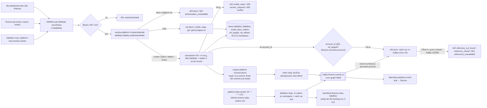

# 01 — Business process (As-Is / To-Be)

finance-liabilities-api (cell `liabilities`) เก็บหนี้และภาระที่ต้องจ่าย (loan, credit, tax, payable, subscription, other) พร้อมเงินต้น ยอดคงค้าง ค่างวดขั้นต่ำ ดอกเบี้ย วันครบกำหนด และสถานะ ต่อ scope; `account_id` ชี้ไปที่ account ใน `finance-accounts-api` และ owner ใช้ผ่าน `life-dashboard-web`, `finance-api` และ MCP

Last reviewed: 2026-11-27 · commit `c3b9751`

## As-Is (จากโค้ดวันนี้)

Sources: `cell.yaml`, `pyproject.toml` (platform-cellkit v1.1.1: `cellkit/app.py`, `cellkit/refs.py`, `cellkit/relay.py`, `cellkit/gateway.py`), `migrations/0001_liabilities.sql`–`0005_cross_references.sql`, `.github/workflows/relay-outbox.yml`, `.railway/railway.ts`, `README.md`, `PRODUCT.md`, `specs/006-cross-service-references/spec.md`

ข้อเท็จจริงสำคัญจากโค้ด:

- โค้ดของ cell มีแค่ `cell.yaml`; route, auth, outbox, refs และ relay มาจาก platform-cellkit v1.1.1 (`src/solo_liabilities/` ว่าง)
- กฎ: `name` (ไม่เกิน 200 ตัว) และ `liability_type` บังคับ; `status` ค่าเริ่มต้น active (planned, active, overdue, settled, cancelled); `principal_amount`, `outstanding_amount`, `minimum_payment` เป็น `money` และ `interest_rate_percent` เป็น `decimal` ติดลบไม่ได้; `currency` ISO 4217 ค่าเริ่มต้น THB; `metadata` เป็น JSON object; PATCH ที่ส่งฟิลด์เงินต้องมี `expected_version` (428, SPEC-009)
- `account_id` (`references: finance-accounts.account`, `refuse_status: [closed]`): create หรือ patch ที่ตั้งค่านี้ถูกตรวจกับสำเนาที่มาจาก event; patch ที่ไม่เปลี่ยนค่าไม่ถูกตรวจซ้ำ (SPEC-006)
- liability ไม่มี `referenced_by`: ลบหรือ erase ได้โดยไม่ต้องรอ cell อื่น; event `deleted` ทำให้ finance-accounts รู้ว่า account ไม่ถูกชี้แล้ว
- event `liabilities.liability.created/updated/deleted` มีเฉพาะ `liability_type`, `scope`, `account_id`, `currency`, `due_date`, `status` (ไม่มียอดเงิน ชื่อ หรือ notes)
- ไม่มีโค้ดเปลี่ยน `status` เป็น overdue เมื่อเลย `due_date`; ผู้เรียกต้องตั้งเอง [ต้องยืนยัน: job หรือคนที่ทำ]
- `POST /v1/liabilities/erase` ต้องมี `confirm` = workspace ของผู้เรียก ลบทีละ 1-500 แถว (ค่าเริ่มต้น 200; SPEC-008)
- การตรวจ `X-Gateway-Assertion` (off/report/enforce), inline relay และ `LIABILITIES_REFS_DATABASE_URL` ขึ้นกับตัวแปรบน Railway [ต้องยืนยัน: ค่าใน production]

## To-Be (จาก `PRODUCT.md` §Measures และ `specs/004-identity-issuer-trust/spec.md`)

- `specs/004-identity-issuer-trust/spec.md`: cell เชื่อ token ของ platform-identity เคียงข้าง empire-platform; โค้ดอยู่ใน kit แล้ว แต่ "production activation needs a separate owner go"
- `PRODUCT.md` §Measures (Proposed, ยังไม่มีอะไรเก็บ): ยอดคงค้างรวมของ liability active และ overdue ต่อสกุลเงิน (dashboard แสดงอยู่แล้ว), จำนวน liability ที่ overdue (เป้า 0), 5xx และ p95 latency ของ `/v1/liabilities`
- `PRODUCT.md` §Product Purpose: อะไรที่เลยกำหนดต้องถูกทำเครื่องหมาย overdue ให้ dashboard แสดง
- `PRODUCT.md` §Capabilities: out of scope = ตารางผ่อน, การคิดดอกเบี้ย และการจ่ายเงินจริง (`finance-transactions-api`)

## Gap

| ID | As-Is → To-Be | Status | Owner | Evidence |
|---|---|---|---|---|
| G1 | รับ token ของ platform-identity ได้ในโค้ด แต่ยังไม่ยืนยันว่าเปิดใน production → owner ตัดสินเปิดใช้ (ตั้ง `LIABILITIES_JWT_IDENTITY_*`) | decide | owner | `specs/004-identity-issuer-trust/spec.md` (Status) |
| G2 | ไม่มีอะไรเก็บ Measures ที่เสนอไว้ → เก็บและรายงานตาม `PRODUCT.md` | decide | owner | `PRODUCT.md` §Measures ("Proposed (nothing collects them yet)") |
| G3 | ไม่มีอะไรตั้ง overdue เมื่อเลย `due_date` → สิ่งที่เลยกำหนดถูกทำเครื่องหมาย overdue | decide | owner | `PRODUCT.md` §Product Purpose และ §Capabilities [ต้องยืนยัน] |

## Open questions

- `PRODUCT.md` §Capabilities ยังเขียนว่า `account_id` "does not check that the account exists" แต่โค้ดวันนี้ (SPEC-006) ตรวจและปฏิเสธ account ที่ไม่มีหรือปิดแล้ว; ควรแก้ `PRODUCT.md`
- `finance-ledger-core` (`book-finance-api`) อ่าน `/v1/liabilities` จริงหรือไม่ (PRODUCT.md ระบุ `[ต้องยืนยัน]`)
- โหมด gateway assertion และ signed events (`LIABILITIES_EVENT_SIGNATURES`) ใน production เป็นค่าใด
